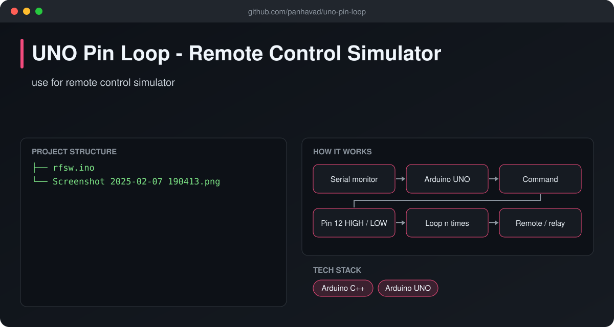
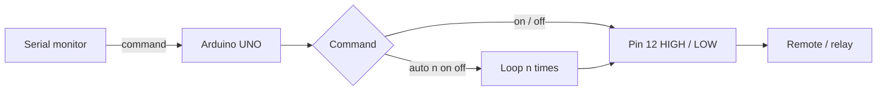

# UNO Pin Loop - Remote Control Simulator

  [](https://github.com/panhavad/uno-pin-loop/releases/latest)

An **Arduino UNO sketch that simulates pressing a remote-control button** by switching an output pin from serial commands. Use manual `on`/`off` or an **auto loop** with custom on/off timing - great for testing RF switches and devices.



## Features

- Serial commands: `on`, `off`, `auto <loops> <on_ms> <off_ms>`
- Auto mode with countdown output
- Manual command instantly exits auto mode
- Pin 12 output, pin 13 input

## How it works



## Getting started

Upload `rfsw.ino`, open Serial Monitor at **9600 baud** and type:

```
on
off
auto 10 500 2000
```

## Download

Grab the packaged source from the [latest release](https://github.com/panhavad/uno-pin-loop/releases/latest).

## Tech stack

- Arduino C++
- Arduino UNO

## Project structure

```text
uno-pin-loop/
├── docs/
├── README.md
├── rfsw.ino
└── Screenshot 2025-02-07 190413.png
```
